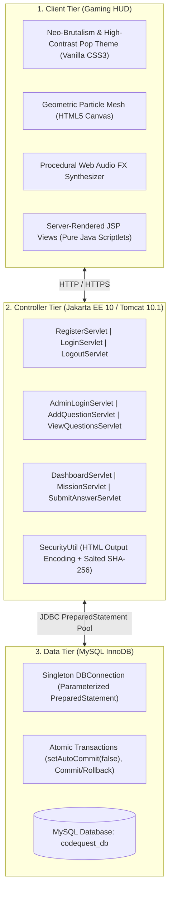

# ⚡ CodeQuest — Gamified Programming Arena

[](https://dilipkumarprudhvi-a11y.github.io/CodeQuest/)
[](https://jakarta.ee/)
[](https://tomcat.apache.org/)
[](https://adoptium.net/)
[](https://www.mysql.com/)

> **Academic Submission Grade**: Enterprise Dynamic Web Project (Jakarta EE 10, Pure JSP Scriptlets, JDBC, MySQL)  
> **Official Live Application**: **[https://dilipkumarprudhvi-a11y.github.io/CodeQuest/](https://dilipkumarprudhvi-a11y.github.io/CodeQuest/)**  
> **GitHub Repository**: [https://github.com/dilipkumarprudhvi-a11y/CodeQuest](https://github.com/dilipkumarprudhvi-a11y/CodeQuest)

---

## 🚀 Live Application

Experience the full interactive gamified arena directly in your browser:

### 👉 **[https://dilipkumarprudhvi-a11y.github.io/CodeQuest/](https://dilipkumarprudhvi-a11y.github.io/CodeQuest/)**

* **Interactive Mission Solver**: Complete Java, SQL, and DSA missions with instant protocol evaluation.
* **Olympic 3D Podium**: Real-time rank calculation with elevated gold crown, silver, and bronze steps.
* **Cadet Cockpit**: Dynamic animated XP progress bar advancing from Level 1 Novice Cadet to Level 5 Cyber Grandmaster.
* **Procedural Sound FX**: Zero-dependency Web Audio API synthesizer for acoustic hover, victory, and failure feedback.

---

## 🎮 System Architecture & Strict Academic Constraints

CodeQuest is built to satisfy rigorous enterprise Java standards and academic evaluation criteria:



### Core Architectural Rules Enforced
1. **Zero JSTL & Zero JSP EL**: Dynamic server rendering uses 100% pure Java scriptlets (`<% ... %>`, `<%= ... %>`). No `<c:...>` tags and no `${...}` expressions.
2. **Atomic JDBC Transactions**: Answer submissions and student XP/level updates execute inside a single transactional block (`conn.setAutoCommit(false)` $\to$ `commit()` / `rollback()`).
3. **One-Attempt Rule**: Each student is restricted to exactly one submission per challenge, enforced via database composite constraint (`uq_user_mission`) and application-layer guards.
4. **OWASP Top 10 Hardened**: HTML output encoding via `SecurityUtil.encodeHtml` against XSS, salted SHA-256 (`CQ256`) password hashing, session fixation countermeasures, and SQL stack trace suppression.

---

## 📋 Module Compliance Matrix (Modules 1 – 12)

| Module | Requirement | Key Files | Implementation Status |
| :--- | :--- | :--- | :---: |
| **Module 1** | **Home Page & Gaming HUD** | `index.html`, `css/style.css`, `js/game-fx.js` | ✅ **Complete**: Cyber-obsidian canvas mesh, live ticker, Web Audio synthesizer. |
| **Module 2** | **Student Registration** | `register.jsp`, `RegisterServlet.java` | ✅ **Complete**: Regex validation, unique call-sign check, starts at 0 XP & Level 1. |
| **Module 3** | **Student Login & Session** | `login.jsp`, `LoginServlet.java`, `LogoutServlet.java` | ✅ **Complete**: Dual-mode login, session fixation protection, `HttpOnly` cookies. |
| **Module 4** | **Admin Login & Console** | `admin-login.jsp`, `AdminLoginServlet.java`, `admin-dashboard.jsp` | ✅ **Complete**: Role isolation (`SYSTEM_ADMIN`), `ServletConfig` & `ServletContext` telemetry. |
| **Module 5** | **Database Design & JDBC** | `codequest_db.sql`, `DBConnection.java` | ✅ **Complete**: Reusable singleton, parameterized `PreparedStatement`, foreign keys. |
| **Module 6** | **Admin Question Creation** | `add-question.jsp`, `AddQuestionServlet.java` | ✅ **Complete**: Dynamic multi-choice creation for Java, SQL, DSA with custom XP bounties. |
| **Module 7** | **Question Management** | `view-questions.jsp`, `ViewQuestionsServlet.java` | ✅ **Complete**: Full tabular inventory with category badges and secure POST deletion. |
| **Module 8** | **Student Dashboard** | `dashboard.jsp`, `DashboardServlet.java` | ✅ **Complete**: Real-time XP, level rank titles, dynamic animated striped progress bar. |
| **Module 9** | **Missions Deck** | `missions.jsp`, `MissionServlet.java` | ✅ **Complete**: Category filters; **omits correct answer from student view**; flags completed quests. |
| **Module 10** | **Evaluation & XP Engine** | `mission-result.jsp`, `SubmitAnswerServlet.java` | ✅ **Complete**: **Atomic transaction**, **one-attempt rule**, dynamic level promotions. |
| **Module 11** | **Global Leaderboard** | `leaderboard.jsp`, `LeaderboardServlet.java` | ✅ **Complete**: Real-time descending rank, Olympic 3D podium (Gold, Silver, Bronze). |
| **Module 12** | **Integration & Security** | Full Application Stack | ✅ **Complete**: Clean PRG redirect patterns, error handling, zero generic error pages. |

---

## 🛠️ Local Enterprise Deployment (Apache Tomcat 10.1)

To run the full enterprise Java backend with live MySQL database persistence locally:

### 1. Database Setup
1. Open **MySQL Workbench** or run `setup_db.bat`.
2. Execute `database/codequest_db.sql` to initialize tables and seed data.
3. Database defaults to port `3306`, user `root`, database `codequest_db`. (Update password in `web.xml` if necessary).

### 2. Build & Deploy
1. Run `build.bat` in the project root to compile all Java source files:
   ```cmd
   build.bat
   ```
2. Start Apache Tomcat 10.1:
   ```cmd
   apache-tomcat-10.1.60\bin\startup.bat
   ```
3. Open your browser and navigate to the local runtime:  
   👉 **`http://localhost:8080/CodeQuest/`**

### 3. Import into Eclipse IDE
1. Open **Eclipse IDE for Enterprise Java**.
2. Select **File $\to$ Open Projects from File System...** and choose this project folder.
3. Right-click project $\to$ **Run As $\to$ Run on Server** $\to$ Select **Apache Tomcat v10.1**.

---

## 🔑 Test Credentials

### Administrator Portal
* **URL**: `http://localhost:8080/CodeQuest/admin-login.jsp`
* **Username**: `admin`
* **Password**: `admin123`

### Seeded Student Warriors
* `CyberKnight` / `Warrior123!` (Level 3 • 320 XP)
* `NeonCoder` / `Warrior123!` (Level 3 • 250 XP)
* `BinaryPhantom` / `Warrior123!` (Level 2 • 180 XP)
* *(Or register a new student account from the registration portal)*

---

## 📄 License & Attribution
Developed for academic submission. Built with Jakarta Servlets 6.0, JSP 3.1, JDBC, MySQL, HTML5, CSS3, and the Web Audio API.
