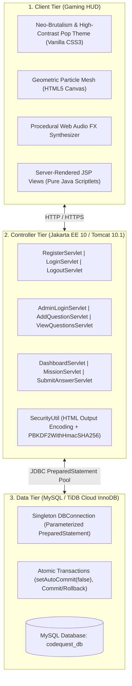

# CodeQuest — Gamified Programming Arena

[](https://codequest-ukq0.onrender.com/)
[](https://dilipkumarprudhvi-a11y.github.io/CodeQuest/)
[](https://jakarta.ee/)
[](https://tomcat.apache.org/)
[](https://adoptium.net/)
[](https://www.mysql.com/)

> **Live Full-Stack Cloud Deployment (Render + TiDB Cloud MySQL)**: **[CodeQuest - Game-Based Programming Arena](https://codequest-ukq0.onrender.com/)**  
> **Static Frontend (GitHub Pages)**: **[https://dilipkumarprudhvi-a11y.github.io/CodeQuest/](https://dilipkumarprudhvi-a11y.github.io/CodeQuest/)**  
> **GitHub Repository**: **[https://github.com/dilipkumarprudhvi-a11y/CodeQuest](https://github.com/dilipkumarprudhvi-a11y/CodeQuest)**  
> **Academic Grade**: Enterprise Dynamic Web Project (Jakarta EE 10, Pure JSP Scriptlets, JDBC, TiDB/MySQL)

---

## Live Deployments

### 1. Full-Stack Production Backend (Render + TiDB Cloud MySQL)
Experience the full server-side application with live database persistence, user registration, authentication, admin console, and evaluation engine:
* **Live URL**: **[CodeQuest - Game-Based Programming Arena](https://codequest-ukq0.onrender.com/)**
* **Admin Portal**: [https://codequest-ukq0.onrender.com/admin-login.jsp](https://codequest-ukq0.onrender.com/admin-login.jsp)
* **Cadet Login**: [https://codequest-ukq0.onrender.com/login.jsp](https://codequest-ukq0.onrender.com/login.jsp)
* **Student Registration**: [https://codequest-ukq0.onrender.com/register.jsp](https://codequest-ukq0.onrender.com/register.jsp)

### 2. Static Client Application (GitHub Pages)
Interactive client-side runtime with sandboxed Web Worker execution:
* **Live URL**: [https://dilipkumarprudhvi-a11y.github.io/CodeQuest/](https://dilipkumarprudhvi-a11y.github.io/CodeQuest/)

---

## System Architecture & Strict Academic Constraints

CodeQuest is built to satisfy rigorous enterprise Java standards and academic evaluation criteria:



### Core Architectural Rules Enforced
1. **Zero JSTL & Zero JSP EL**: Dynamic server rendering uses 100% pure Java scriptlets (`<% ... %>`, `<%= ... %>`). No `<c:...>` tags and no `${...}` expressions.
2. **Atomic JDBC Transactions**: Answer submissions and student XP/level updates execute inside a single transactional block (`conn.setAutoCommit(false)` $\to$ `commit()` / `rollback()`).
3. **One-Attempt Rule**: Each student is restricted to exactly one submission per challenge, enforced via database composite constraint (`uq_user_mission`) and application-layer guards.
4. **OWASP Top 10 Hardened**: HTML output encoding via `SecurityUtil.encodeHtml` against XSS, NIST PBKDF2 password hashing, session fixation countermeasures, and SQL stack trace suppression.

---

## Module Compliance Matrix (Modules 1 – 12)

| Module | Requirement | Key Files | Implementation Status |
| :--- | :--- | :--- | :---: |
| **Module 1** | **Home Page & Gaming HUD** | `index.html`, `css/style.css`, `js/game-fx.js` | **Complete**: Cyber-obsidian canvas mesh, live ticker, Web Audio synthesizer. |
| **Module 2** | **Student Registration** | `register.jsp`, `RegisterServlet.java` | **Complete**: Regex validation, unique call-sign check, starts at 0 XP & Level 1. |
| **Module 3** | **Student Login & Session** | `login.jsp`, `LoginServlet.java`, `LogoutServlet.java` | **Complete**: Dual-mode login, session fixation protection, `HttpOnly` cookies. |
| **Module 4** | **Admin Login & Console** | `admin-login.jsp`, `AdminLoginServlet.java`, `admin-dashboard.jsp` | **Complete**: Role isolation (`SYSTEM_ADMIN`), `ServletConfig` & `ServletContext` telemetry. |
| **Module 5** | **Database Design & JDBC** | `codequest_db.sql`, `DBConnection.java` | **Complete**: Reusable singleton, parameterized `PreparedStatement`, foreign keys. |
| **Module 6** | **Admin Question Creation** | `add-question.jsp`, `AddQuestionServlet.java` | **Complete**: Dynamic multi-choice & coding challenge creation with custom XP bounties. |
| **Module 7** | **Question Management** | `view-questions.jsp`, `ViewQuestionsServlet.java` | **Complete**: Full tabular inventory with category badges and secure POST deletion. |
| **Module 8** | **Student Dashboard** | `dashboard.jsp`, `DashboardServlet.java` | **Complete**: Real-time XP, level rank titles, dynamic animated striped progress bar. |
| **Module 9** | **Missions Deck** | `missions.jsp`, `MissionServlet.java` | **Complete**: Mode & category filters; **omits correct answer from student view**; flags completed quests. |
| **Module 10** | **Evaluation & XP Engine** | `mission-result.jsp`, `SubmitAnswerServlet.java` | **Complete**: **Atomic transaction**, **one-attempt rule**, dynamic level promotions. |
| **Module 11** | **Global Leaderboard** | `leaderboard.jsp`, `LeaderboardServlet.java` | **Complete**: Real-time descending rank, Olympic 3D podium (Gold, Silver, Bronze). |
| **Module 12** | **Integration & Security** | Full Application Stack | **Complete**: Clean PRG redirect patterns, error handling, zero generic error pages. |

---

## Cloud Deployment (Render + TiDB Cloud)

The live full-stack application is containerized with a multi-stage Docker build:
* **Runtime**: Apache Tomcat 10.1 (Jakarta EE 10) on JDK 17
* **Database**: TiDB Cloud Serverless (MySQL 8.0 Protocol)
* **Live Endpoint**: **[https://codequest-ukq0.onrender.com/](https://codequest-ukq0.onrender.com/)**

---

## Local Enterprise Deployment (Apache Tomcat 10.1)

To run the application locally:

### 1. Database Setup
1. Execute `database/codequest_db.sql` in MySQL to initialize tables and seed data.
2. Default local credentials: port `3306`, user `root`, database `codequest_db`.

### 2. Build & Deploy
1. Run `build.bat` in the project root to compile all Java source files:
   ```cmd
   build.bat
   ```
2. Start Apache Tomcat 10.1:
   ```cmd
   apache-tomcat-10.1.60\bin\startup.bat
   ```
3. Open your browser:  
   **`http://localhost:8080/CodeQuest/`**

---

## Test Credentials

### Administrator Portal
* **URL**: `https://codequest-ukq0.onrender.com/admin-login.jsp` (or local `http://localhost:8080/CodeQuest/admin-login.jsp`)
* **Username**: `admin`
* **Password**: `admin123`

### Seeded Student Warriors
* `CyberKnight` / `pass123` (Level 5 • 420 XP)
* `NeonCoder` / `pass123` (Level 4 • 350 XP)
* `BinaryPhantom` / `pass123` (Level 3 • 220 XP)
* `ZeroDay` / `pass123` (Level 2 • 140 XP)
* `AlgoWiz` / `pass123` (Level 1 • 60 XP)
* *(Or register a new student account from the registration portal)*

---

## License & Attribution
Developed for academic submission. Built with Jakarta Servlets 6.0, JSP 3.1, JDBC, MySQL/TiDB, HTML5, CSS3, and the Web Audio API.
